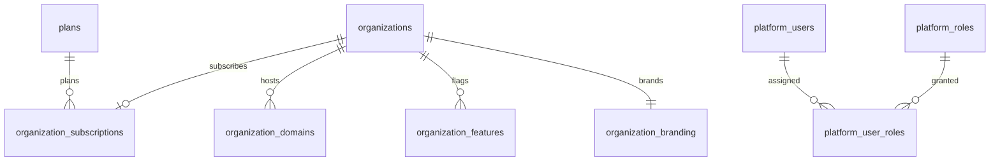
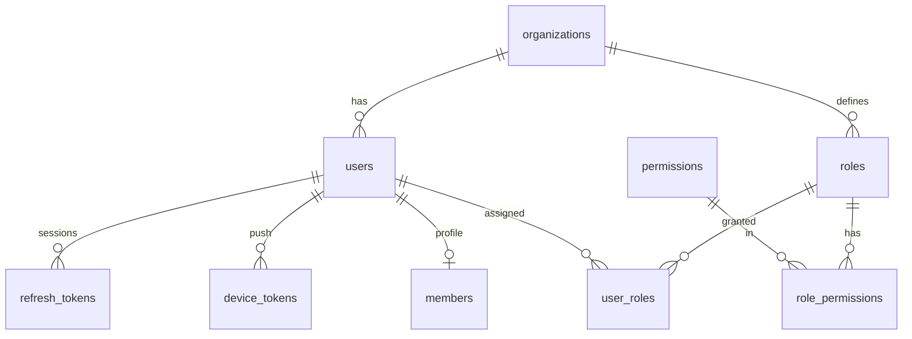
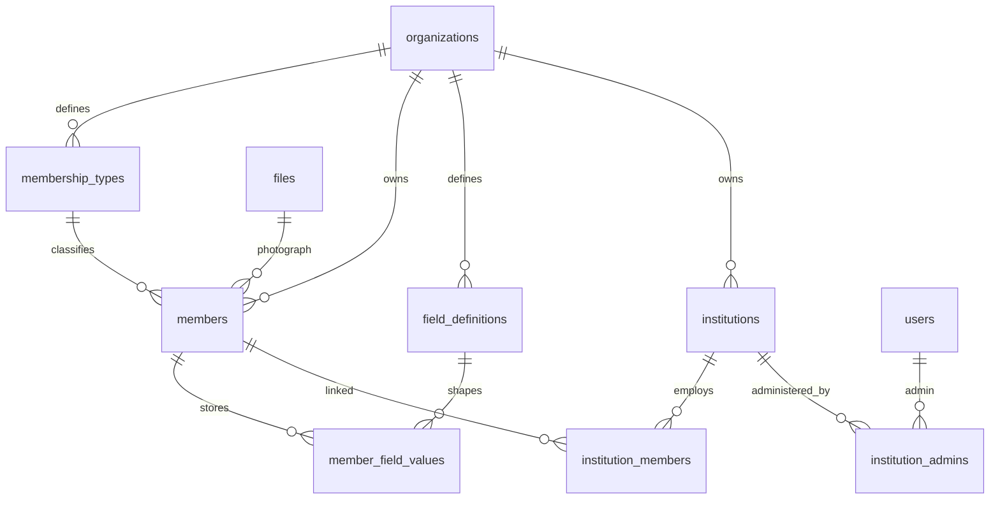
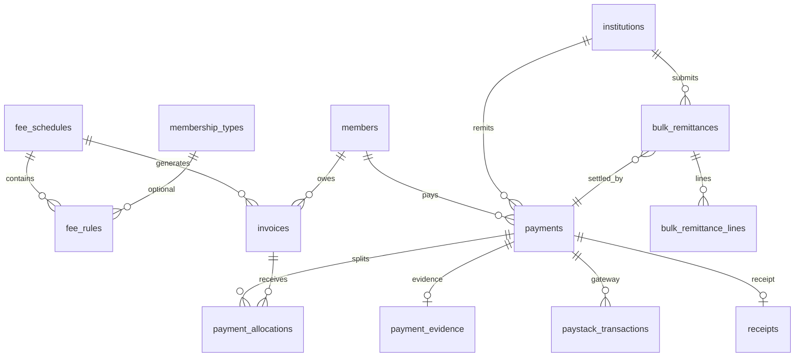
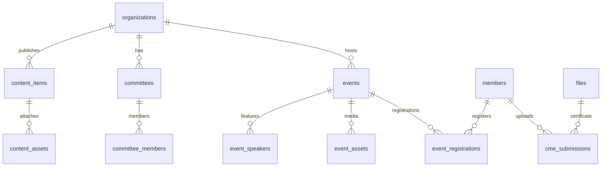
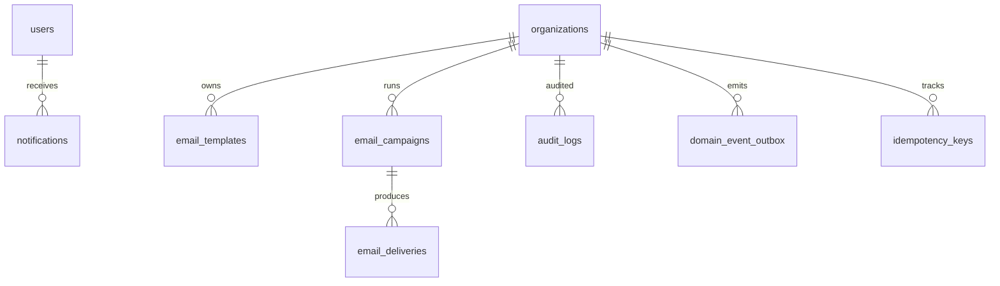

# Association Management Platform — Complete Database Architecture

**Status:** Architecture review only — awaiting approval before any application implementation.  
**Scope:** PostgreSQL + Prisma data model for the multi-tenant Association Management Platform (Ajir).  
**First tenant (data only):** NMA Ogun State Branch — zero org-specific logic in schema.  
**Out of v1 DDL:** Cooperative ledger, elections, national↔branch hierarchy FKs.

---

## Contents

1. [All entities/tables](#1-all-entitiestables)
2. [Relationships](#2-relationships)
3. [Primary keys](#3-primary-keys)
4. [Foreign keys](#4-foreign-keys)
5. [Unique constraints](#5-unique-constraints)
6. [Check constraints](#6-check-constraints)
7. [Composite indexes](#7-composite-indexes)
8. [Normalization decisions](#8-database-normalization-decisions)
9. [Multi-tenant strategy](#9-multi-tenant-strategy)
10. [Soft delete strategy](#10-soft-delete-strategy)
11. [Audit strategy](#11-audit-strategy)
12. [Timestamp strategy](#12-timestamp-strategy)
13. [Migration strategy](#13-migration-strategy)
14. [Prisma schema](#14-prisma-schema)
15. [PostgreSQL-specific optimizations](#15-postgresql-specific-optimizations)
16. [ERD](#16-erd-entity-relationship-diagram)
17. [Purpose of every table](#17-purpose-of-every-table)
18. [Why each index exists](#18-why-each-index-exists)
19. [Why each relationship exists](#19-why-each-relationship-exists)

---

## Locked conventions

| Concern | Decision |
|---|---|
| RDBMS | PostgreSQL 16+ |
| ORM | Prisma (schema in [schema.prisma](./schema.prisma); RLS via raw SQL migrations) |
| Primary keys | `UUID` via `gen_random_uuid()` |
| Money | `BIGINT` minor units (`*_kobo`) + `CHAR(3)` / `String` currency — never floating point |
| Tenancy | Shared schema + `organization_id` + **Row Level Security** |
| Org model | **Flat** tenants (no `parent_organization_id` in v1) |
| Custom attributes | `field_definitions` + `member_field_values` (JSONB) |
| Time | `TIMESTAMPTZ` / Prisma `DateTime` |
| Naming | `snake_case` tables via `@@map` |

---

## 1. All entities/tables

### Platform (Ajir operator — no tenant RLS)

| Table | Bounded context |
|---|---|
| `plans` | Platform |
| `platform_users` | Platform |
| `platform_roles` | Platform |
| `platform_user_roles` | Platform |
| `organization_subscriptions` | Platform |

### Tenancy

| Table | Bounded context |
|---|---|
| `organizations` | Platform / Tenancy |
| `organization_domains` | Tenancy |
| `organization_features` | Platform |
| `organization_branding` | Tenancy |

### Identity

| Table | Bounded context |
|---|---|
| `users` | Identity |
| `refresh_tokens` | Identity |
| `password_reset_tokens` | Identity |
| `email_verification_tokens` | Identity |
| `device_tokens` | Notifications |

### RBAC

| Table | Bounded context |
|---|---|
| `permissions` | RBAC (global catalog) |
| `roles` | RBAC |
| `role_permissions` | RBAC |
| `user_roles` | RBAC |

### Members & institutions

| Table | Bounded context |
|---|---|
| `membership_types` | Members |
| `members` | Members |
| `field_definitions` | Members |
| `member_field_values` | Members |
| `institutions` | Institutions |
| `institution_members` | Institutions |
| `institution_admins` | Institutions |

### Billing

| Table | Bounded context |
|---|---|
| `fee_schedules` | Billing |
| `fee_rules` | Billing |
| `invoices` | Billing |
| `payments` | Billing |
| `payment_allocations` | Billing |
| `payment_evidence` | Billing |
| `paystack_transactions` | Billing |
| `receipts` | Billing |
| `bulk_remittances` | Billing |
| `bulk_remittance_lines` | Billing |

### Files & CMS

| Table | Bounded context |
|---|---|
| `files` | Files |
| `content_items` | CMS |
| `content_assets` | CMS |
| `committees` | CMS |
| `committee_members` | CMS |

### CME & Events

| Table | Bounded context |
|---|---|
| `cme_submissions` | CME |
| `events` | Events |
| `event_speakers` | Events |
| `event_assets` | Events |
| `event_registrations` | Events |

### Comms, audit, reliability

| Table | Bounded context |
|---|---|
| `email_templates` | Comms |
| `email_campaigns` | Comms |
| `email_deliveries` | Comms |
| `notifications` | Notifications |
| `audit_logs` | Audit |
| `domain_event_outbox` | Shared kernel / infra |
| `idempotency_keys` | Shared / Billing |

**Total:** 48 tables in v1. Cooperative tables deferred to Phase 3.

---

## 2. Relationships

### Cardinality legend

| Notation | Meaning |
|---|---|
| 1:1 | Exactly one related row (enforced by UNIQUE FK) |
| 1:N | One parent, many children |
| N:N | Resolved via explicit join table |

### Platform & tenancy

| From | To | Cardinality | Join |
|---|---|---|---|
| `plans` | `organization_subscriptions` | 1:N | `plan_id` |
| `organizations` | `organization_subscriptions` | 1:1 (active row pattern; history via status/new rows) | `organization_id` UNIQUE |
| `organizations` | `organization_domains` | 1:N | `organization_id` |
| `organizations` | `organization_features` | 1:N | `organization_id` |
| `organizations` | `organization_branding` | 1:1 | `organization_id` PK/FK |
| `platform_users` | `platform_roles` | N:N | `platform_user_roles` |
| `organizations` | `users` | 1:N | `organization_id` |
| `organizations` | almost all tenant tables | 1:N | `organization_id` |

### Identity & RBAC

| From | To | Cardinality | Join |
|---|---|---|---|
| `users` | `refresh_tokens` | 1:N | `user_id` |
| `users` | `password_reset_tokens` | 1:N | `user_id` |
| `users` | `email_verification_tokens` | 1:N | `user_id` |
| `users` | `device_tokens` | 1:N | `user_id` |
| `users` | `members` | 1:0..1 | `members.user_id` |
| `permissions` | `roles` | N:N | `role_permissions` |
| `users` | `roles` | N:N | `user_roles` (optional scope) |

### Members & institutions

| From | To | Cardinality | Join |
|---|---|---|---|
| `membership_types` | `members` | 1:N | `membership_type_id` |
| `field_definitions` | `member_field_values` | 1:N | `field_definition_id` |
| `members` | `member_field_values` | 1:N | `member_id` |
| `members` | `institutions` (primary) | N:1 optional | `primary_institution_id` |
| `members` ↔ `institutions` | N:N | `institution_members` |
| `institutions` | `institution_admins` | 1:N | `institution_id` |
| `users` | `institution_admins` | 1:N | `user_id` |
| `files` | `members` (photo) | 1:N optional | `photograph_file_id` |

### Billing

| From | To | Cardinality | Join |
|---|---|---|---|
| `fee_schedules` | `fee_rules` | 1:N | `fee_schedule_id` |
| `membership_types` | `fee_rules` | 1:N optional | `membership_type_id` |
| `fee_schedules` | `invoices` | 1:N | `fee_schedule_id` |
| `members` | `invoices` | 1:N | `member_id` |
| `members` | `payments` | 1:N optional | `member_id` |
| `institutions` | `payments` | 1:N optional | `institution_id` |
| `payments` ↔ `invoices` | N:N | `payment_allocations` |
| `payments` | `payment_evidence` | 1:0..1 | `payment_id` UNIQUE |
| `payments` | `paystack_transactions` | 1:N | `payment_id` |
| `payments` | `receipts` | 1:0..1 | `payment_id` UNIQUE |
| `institutions` | `bulk_remittances` | 1:N | `institution_id` |
| `bulk_remittances` | `bulk_remittance_lines` | 1:N | `bulk_remittance_id` |
| `bulk_remittances` | `payments` | N:1 optional | `payment_id` |
| `files` | `payment_evidence` / `receipts` | 1:N | `file_id` |

### CMS, CME, Events

| From | To | Cardinality | Join |
|---|---|---|---|
| `content_items` | `content_assets` | 1:N | `content_item_id` |
| `committees` | `committee_members` | 1:N | `committee_id` |
| `members` | `cme_submissions` | 1:N | `member_id` |
| `files` | `cme_submissions` | 1:N | `file_id` |
| `events` | `event_speakers` | 1:N | `event_id` |
| `events` | `event_assets` | 1:N | `event_id` |
| `events` ↔ `members` | N:N | `event_registrations` |

### Comms & reliability

| From | To | Cardinality | Join |
|---|---|---|---|
| `email_campaigns` | `email_deliveries` | 1:N optional | `campaign_id` |
| `users` | `notifications` | 1:N | `user_id` |
| `organizations` | `audit_logs` | 1:N optional | `organization_id` (null = platform) |

---

## 3. Primary keys

Every table uses:

```text
id UUID PRIMARY KEY DEFAULT gen_random_uuid()
```

**Exceptions (natural composite or shared PK):**

| Table | PK |
|---|---|
| `organization_branding` | `organization_id` (1:1 shares org PK) |
| `role_permissions` | `(role_id, permission_id)` |
| `platform_user_roles` | `(platform_user_id, platform_role_id)` |

Surrogate UUIDs are preferred over sequential integers so IDs are opaque across tenants, merge-safe, and unguessable in URLs.

---

## 4. Foreign keys

All FKs use `ON DELETE` deliberately:

| Pattern | ON DELETE | Examples |
|---|---|---|
| Tenant child → organization | `RESTRICT` | Most `organization_id` FKs (prevent accidental org wipe) |
| Soft-deletable parent | `RESTRICT` | `members`, `institutions` — children remain until orphan policy handled in app |
| Join / dependent lines | `CASCADE` | `fee_rules`→schedule, `payment_allocations`→payment, `bulk_remittance_lines`→header, `role_permissions`→role |
| Optional file refs | `SET NULL` | `photograph_file_id`, cover images |
| Auth tokens → user | `CASCADE` | `refresh_tokens`, reset/verify tokens |

**Every tenant table that stores business data includes `organization_id` even when a parent already implies it** (e.g. `payment_allocations.organization_id`). This enables RLS policies without joins and keeps queries tenant-scoped.

---

## 5. Unique constraints

| Table | Constraint | Notes |
|---|---|---|
| `plans` | `code` | Global plan codes |
| `platform_users` | `email` | Operator emails |
| `organizations` | `slug` | URL-safe tenant key |
| `organization_domains` | `hostname` | Global host → org map |
| `organization_domains` | `(organization_id, purpose)` WHERE `is_primary` | One primary host per purpose |
| `organization_features` | `(organization_id, feature_key)` | |
| `organization_subscriptions` | `organization_id` | One subscription row pointer (or enforce via status in app if history kept) |
| `users` | `(organization_id, email)` WHERE `deleted_at IS NULL` | Email unique **per tenant** |
| `refresh_tokens` | `token_hash` | |
| `password_reset_tokens` / `email_verification_tokens` | `token_hash` | |
| `device_tokens` | `token` | FCM token globally unique |
| `permissions` | `key` | Global catalog |
| `roles` | `(organization_id, key)` | |
| `user_roles` | `(user_id, role_id, scope_type, scope_id)` | Scoped assignment uniqueness |
| `membership_types` | `(organization_id, code)` WHERE `deleted_at IS NULL` | |
| `members` | `(organization_id, membership_no)` WHERE not null & active | |
| `members` | `(organization_id, user_id)` WHERE user_id not null & active | One member profile per user/org |
| `field_definitions` | `(organization_id, entity, key)` WHERE active | |
| `member_field_values` | `(member_id, field_definition_id)` | |
| `institutions` | `(organization_id, code)` WHERE code not null & active | |
| `institution_members` | `(institution_id, member_id)` WHERE `employment_status = 'active'` | Partial |
| `institution_admins` | `(institution_id, user_id)` | |
| `fee_schedules` | `(organization_id, code)` | |
| `invoices` | `(organization_id, invoice_no)` | |
| `invoices` | `(member_id, fee_schedule_id)` WHERE status not cancelled/void | One open dues invoice per period |
| `payments` | `(organization_id, reference)` | Idempotency / gateway reference |
| `payment_allocations` | `(payment_id, invoice_id)` | |
| `payment_evidence` | `payment_id` | 1:1 |
| `paystack_transactions` | `paystack_reference` | |
| `receipts` | `payment_id`; `(organization_id, receipt_no)` | |
| `files` | `(bucket, object_key)` | R2 object identity |
| `content_items` | `(organization_id, type, slug)` WHERE active | |
| `committees` | `(organization_id, slug)` WHERE active | |
| `events` | `(organization_id, slug)` WHERE active | |
| `event_registrations` | `(event_id, member_id)` | |
| `email_templates` | `(organization_id, key)` | |
| `idempotency_keys` | `(organization_id, key)` | |

Partial unique indexes (soft delete / status) are created in raw SQL migrations — Prisma `@@unique` covers full uniques; document partials in §7 and migration SQL.

---

## 6. Check constraints

| Table | Check | Purpose |
|---|---|---|
| `organization_domains.purpose` | IN (`web`,`portal`,`api`) | Host role |
| `users.status` | IN (`invited`,`active`,`disabled`) | Lifecycle |
| `members.sex` | IN (`male`,`female`,`other`,`unspecified`) OR NULL | Optional demographics |
| `members.status` | IN (`draft`,`pending_approval`,`active`,`suspended`,`archived`) | Lifecycle |
| `fee_rules.amount_kobo` | `>= 0` | Allow zero-fee rules |
| `payments.amount_kobo` | `> 0` | No zero payments |
| `payment_allocations.amount_kobo` | `> 0` | |
| `payments` | payer XOR: member vs institution | Enforce payer shape |
| `invoices.amount_*` | `>= 0` | |
| `files.visibility` | IN (`private`,`public`) | |
| `cme_submissions.status` | IN (`pending`,`approved`,`rejected`) | |
| `event_registrations.status` | IN (`registered`,`cancelled`,`attended`,`no_show`) | |
| Money/currency columns | `currency` length 3 | ISO-ish codes |

Stable cross-tenant closed sets may also use PostgreSQL `ENUM` types (mirrored in Prisma enums). Tenant-varying vocabularies (`membership_types.code`, `institutions.institution_type`) stay as `TEXT` + app validation so NBA/alumni tenants are not forced into medical enums.

---

## 7. Composite indexes

| Index | Columns | Type |
|---|---|---|
| `users_org_email_active` | `(organization_id, email)` | UNIQUE partial WHERE `deleted_at IS NULL` |
| `members_org_status` | `(organization_id, status)` | BTREE |
| `members_org_name` | `(organization_id, last_name, first_name)` | BTREE |
| `members_org_institution` | `(organization_id, primary_institution_id)` | BTREE |
| `members_org_membership_no` | `(organization_id, membership_no)` | UNIQUE partial |
| `content_org_type_status_pub` | `(organization_id, type, status, published_at DESC)` | BTREE |
| `invoices_org_status` | `(organization_id, status)` | BTREE |
| `payments_org_status` | `(organization_id, status)` | BTREE |
| `payments_org_reference` | `(organization_id, reference)` | UNIQUE |
| `cme_org_status` | `(organization_id, status)` | BTREE |
| `cme_member_completed` | `(member_id, completed_on DESC)` | BTREE |
| `email_deliveries_org_status_created` | `(organization_id, status, created_at)` | BTREE |
| `notifications_user_created` | `(user_id, created_at DESC)` | BTREE |
| `audit_org_created` | `(organization_id, created_at DESC)` | BTREE |
| `audit_entity` | `(entity_type, entity_id)` | BTREE |
| `outbox_unprocessed` | `(processed_at, occurred_at)` | BTREE (poll unpaid) |
| `domains_org_purpose` | `(organization_id, purpose)` | BTREE |
| `fee_rules_schedule_priority` | `(fee_schedule_id, priority)` | BTREE |
| `files_org_created` | `(organization_id, created_at DESC)` | BTREE |
| `institution_members_member` | `(member_id)` | BTREE |
| `refresh_tokens_family` | `(family_id)` | BTREE |
| `refresh_tokens_user` | `(user_id)` | BTREE |
| `idempotency_org_key` | `(organization_id, key)` | UNIQUE |

Leading with `organization_id` is mandatory for tenant query plans under RLS.

---

## 8. Database normalization decisions

| Decision | Normal form impact | Rationale |
|---|---|---|
| Single `content_items` with `type` discriminator | Controlled denormalization vs 8 near-identical tables | One publish workflow, one SEO model, reusable for any association type; type-specific data in `attributes` JSONB |
| `member_field_values.value` JSONB | Not pure 1NF scalar | Commercial extensibility without DDL per tenant attribute; definitions table keeps catalog normalized |
| `organization_id` denormalized onto child rows | Deliberate redundancy | RLS + query performance without join to parent |
| `payments.amount_kobo` + allocations | 3NF for money movement | Header amount is the collected total; allocations are the settlement breakdown |
| `paystack_transactions` separate from `payments` | 3NF / anti-corruption | Gateway payload isolation; billing domain stays provider-agnostic |
| No storing computed “balance” column on members | Avoid update anomalies | Balance = sum(open invoices) − allocations (query/materialized view later if needed) |
| Branding 1:1 split table | 3NF optional | Keeps `organizations` row lean; branding churn does not rewrite core tenant row |
| Email template per org copy | Not global | Tenants customize copy; optional future inheritance omitted in flat model |
| Append-only `audit_logs` | Event sourcing lite | No update-in-place of audit |

**Not used:** EAV for core money/membership identity; those remain first-class columns.

---

## 9. Multi-tenant strategy

```text
Shared PostgreSQL database
  └── Shared schema (public)
        ├── Platform tables (no organization_id / no tenant RLS)
        └── Tenant tables (organization_id NOT NULL + FORCE ROW LEVEL SECURITY)
```

**Resolution path**

1. HTTP `Host` → `organization_domains.hostname` (Redis-cached) → `organization_id`
2. Request opens DB transaction
3. `SET LOCAL app.organization_id = '<uuid>'`
4. Optionally `SET LOCAL app.is_platform = 'true'` for Platform Operator after separate auth
5. All queries constrained by RLS; application repositories still filter by `organization_id` (defense in depth)

**Isolation level:** Row-level within shared schema — cost-efficient for SaaS; strong enough with FORCE RLS + non-superuser app role.

**Flat tenants:** Each association (NMA Ogun, NMA Lagos, NBA Ikeja) is an independent `organizations` row. Cross-branch national rollups are a future concern (no FK hierarchy in v1).

**Feature flags:** `organization_features` gates CME, Paystack, cooperative, etc., without schema forks.

---

## 10. Soft delete strategy

| Category | Soft delete? | Mechanism |
|---|---|---|
| `organizations`, `users`, `members`, `institutions`, `membership_types`, `field_definitions`, `files`, `content_items`, `committees`, `events` | Yes | `deleted_at TIMESTAMPTZ NULL` |
| Financial ledgers (`payments`, `invoices`, `allocations`, `receipts`) | **No** | Status transitions (`void`, `cancelled`, `rejected`, `refunded`) |
| `audit_logs`, `domain_event_outbox`, `email_deliveries` | **No** | Append-only / immutable history |
| Tokens | Revoke via `revoked_at` / `used_at` | Not soft-deleted rows |

**Unique indexes** that involve soft-deletable natural keys are **partial**: `WHERE deleted_at IS NULL` so a new row may reuse a slug/email after delete.

**Reads:** Default repositories add `deleted_at IS NULL`. Platform “restore” is an explicit use case.

---

## 11. Audit strategy

| Layer | What |
|---|---|
| `audit_logs` | Who/what/when for sensitive actions: payment verify/reject, member activate, exemption grant, CMS publish, role assign, platform org provision |
| Financial tables | Status + `verified_by_user_id` / `verified_at` as first-class columns (queryable) in addition to audit entries |
| `domain_event_outbox` | Reliable integration events (`PaymentVerified`, `MemberActivated`) — not a human audit trail |
| Immutability | `audit_logs` has no `updated_at`; no UPDATE/DELETE granted to app role |

**Row shape:** `actor_type`, `actor_id`, `action`, `entity_type`, `entity_id`, `before` JSONB, `after` JSONB, `ip`, `user_agent`, `organization_id` (nullable for platform).

---

## 12. Timestamp strategy

| Column | Used on | Meaning |
|---|---|---|
| `created_at` | All tables | Insert time (`DEFAULT now()`) |
| `updated_at` | Mutable tables | Last update; maintained by app and/or trigger |
| `deleted_at` | Soft-deletable | Soft delete moment |
| `published_at` / `scheduled_at` | CMS | Editorial lifecycle |
| `paid_at` / `verified_at` / `issued_at` | Billing | Business event times (not same as `created_at`) |
| `expires_at` | Tokens, idempotency | TTL |
| `occurred_at` / `processed_at` | Outbox | Event time vs handler time |
| `last_login_at` | Users | Security/analytics |

All timestamps are **timestamptz** (UTC storage). Organization `timezone` is for display and “association year” boundaries only.

---

## 13. Migration strategy

1. **Source of truth for review:** this document + [schema.prisma](./schema.prisma).
2. **After approval:** place Prisma under `packages/database` (implementation phase — not now).
3. **Baseline migration (greenfield squash):**
   - Extensions: `pgcrypto`, `citext`
   - Enums
   - Platform tables
   - Organizations → domains/features/branding
   - Identity + RBAC + permission seed
   - Files
   - Members / institutions / field defs
   - Billing
   - CMS / CME / Events
   - Comms / notifications
   - Audit / outbox / idempotency
   - RLS policies + `FORCE ROW LEVEL SECURITY`
   - Grants: migrator (bypass), app role (no bypass), readonly
4. **Partial unique indexes & RLS:** raw SQL migration files companion to Prisma migrate.
5. **Expand/Contract** for breaking changes; prefer forward fixes in production.
6. **Seeds:** permissions catalog + plans in migration/seed; **NMA Ogun** as optional seed script (data), never DDL.
7. **CI:** `prisma migrate diff` + policy tests proving cross-tenant SELECT returns 0 rows.
8. **Prod:** backup/PITR snapshot → approve job → migrate → smoke.

**Rollback:** forward-fix preferred; catastrophic → PITR.

---

## 14. Prisma schema

Full Prisma schema for review: **[schema.prisma](./schema.prisma)**.

Notes for reviewers:

- Prisma cannot express all partial unique indexes / RLS; those ship as SQL.
- `Citext` mapped where emails/hostnames need case-insensitive equality (via Prisma preview or native support / Unsupported).
- Money fields are `BigInt`.
- JSONB fields are `Json`.

---

## 15. PostgreSQL-specific optimizations

| Feature | Use |
|---|---|
| **RLS + FORCE** | Tenant isolation at engine level |
| **Partial indexes** | Soft-delete uniques; primary domain per purpose |
| **CITEXT** | Emails, hostnames |
| **JSONB + GIN** (optional later) | `member_field_values.value`, `content_items.attributes`, webhook payloads |
| **BIGINT money** | Exact arithmetic |
| **UUID PKs** | `gen_random_uuid()`; consider UUIDv7 later for B-tree locality |
| **BRIN** (later) | `audit_logs.created_at`, `email_deliveries.created_at` if huge |
| **Connection roles** | App vs migrator vs readonly |
| **`SET LOCAL`** | Transaction-scoped tenant GUC — pooler-safe |
| **Outbox polling index** | Efficient unprocessed event fetch |
| **No table inheritance** | Prefer discriminator + JSONB attributes |
| **Extensions** | `pgcrypto`, `citext` (optional `pg_trgm` for member name search later) |

---

## 16. ERD (Entity Relationship Diagram)

### 16.1 Platform & tenancy



### 16.2 Identity & RBAC



### 16.3 Members & institutions



### 16.4 Billing



### 16.5 CMS, CME, Events



### 16.6 Comms & reliability



---

## 17. Purpose of every table

### Platform

| Table | Purpose |
|---|---|
| `plans` | Commercial product tiers Ajir sells to associations (limits & packaging). |
| `platform_users` | Ajir operator accounts (not tenant members). |
| `platform_roles` | Operator permission sets (`owner`, `support`, `billing`). |
| `platform_user_roles` | N:N assignment of operator roles. |
| `organization_subscriptions` | Which plan an organization is on (trial/active/etc.). |

### Tenancy

| Table | Purpose |
|---|---|
| `organizations` | Root tenant: legal association using the platform. |
| `organization_domains` | Maps hostnames to tenants for web/portal/api. |
| `organization_features` | Per-tenant feature flags and config blobs. |
| `organization_branding` | Logo, colors, email from-identity for white-label. |

### Identity

| Table | Purpose |
|---|---|
| `users` | Authenticatable accounts scoped to one organization. |
| `refresh_tokens` | Hashed refresh tokens with rotation families. |
| `password_reset_tokens` | Single-use reset secrets. |
| `email_verification_tokens` | Email verification secrets. |
| `device_tokens` | FCM device registration for push. |

### RBAC

| Table | Purpose |
|---|---|
| `permissions` | Global permission catalog (`payments.verify`, …). |
| `roles` | Per-org named role templates (Treasurer, Secretariat, …). |
| `role_permissions` | Permissions granted to a role. |
| `user_roles` | User↔role assignment with optional institution/committee scope. |

### Members & institutions

| Table | Purpose |
|---|---|
| `membership_types` | Tenant-defined member categories (not hardcoded “doctor”). |
| `members` | Membership aggregate: identity profile + status + dues exemption. |
| `field_definitions` | Admin-defined custom attribute schema per org/entity. |
| `member_field_values` | Values for custom attributes (MDCN no., matric no., …). |
| `institutions` | Hospitals/clinics/org units under the association. |
| `institution_members` | Employment/affiliation history between members and institutions. |
| `institution_admins` | Which users administer an institution portal. |

### Billing

| Table | Purpose |
|---|---|
| `fee_schedules` | A dues season/product (e.g. 2026 Annual Dues). |
| `fee_rules` | Pricelist rows (by type/age/ownership); encodes 70+ optional exemption policy flags. |
| `invoices` | Amount a member owes for a schedule. |
| `payments` | Money collected attempt (Paystack, manual, bulk). |
| `payment_allocations` | How a payment settles one or more invoices. |
| `payment_evidence` | Uploaded transfer proof for manual channel. |
| `paystack_transactions` | Gateway-specific initialize/webhook payloads. |
| `receipts` | Issued receipt documents/numbers. |
| `bulk_remittances` | Institution bulk dues submission header. |
| `bulk_remittance_lines` | Per-doctor lines including unmatched rows. |

### Files & CMS

| Table | Purpose |
|---|---|
| `files` | Metadata for R2 objects (bytes stay in object storage). |
| `content_items` | Unified CMS documents (pages, news, executives, downloads, …). |
| `content_assets` | Files attached to content (gallery images, downloadables). |
| `committees` | Committee directory entities. |
| `committee_members` | People listed on a committee (member link optional). |

### CME & Events

| Table | Purpose |
|---|---|
| `cme_submissions` | Uploaded CME certificates and review workflow. |
| `events` | Association events. |
| `event_speakers` | Speakers for an event. |
| `event_assets` | Photos/documents for an event. |
| `event_registrations` | Member registration and attendance. |

### Comms & reliability

| Table | Purpose |
|---|---|
| `email_templates` | Per-org transactional/campaign template bodies. |
| `email_campaigns` | Queued bulk email jobs with audience filter. |
| `email_deliveries` | Per-recipient delivery attempts and provider IDs. |
| `notifications` | In-app/push notification records. |
| `audit_logs` | Immutable security/compliance trail. |
| `domain_event_outbox` | Reliable async domain event publication. |
| `idempotency_keys` | Deduplicate payment/API mutations. |

---

## 18. Why each index exists

| Index / unique | Why |
|---|---|
| PK on every `id` | Point lookups, FK targets |
| `organizations.slug` UNIQUE | Stable human key in platform admin & seeds |
| `organization_domains.hostname` UNIQUE | O(1) tenant resolution from Host header |
| `(organization_id, purpose)` on domains | List hosts by role; support primary-host partial unique |
| `(organization_id, feature_key)` | Idempotent feature upsert |
| `(organization_id, email)` users partial unique | Login identity per tenant; allow reuse after soft delete |
| `refresh_tokens.token_hash` UNIQUE | Fast auth presentation lookup |
| `(family_id)` on refresh tokens | Revoke whole rotation family on reuse detection |
| `(user_id)` on refresh tokens | Logout-all-sessions |
| `permissions.key` UNIQUE | Stable permission strings in code |
| `(organization_id, key)` roles | Seed/customize roles without collision |
| User-role scoped unique | Prevent duplicate grants |
| Membership type code unique per org | Fee rules reference stable codes |
| Member membership_no unique per org | Digital ID / public verification |
| Member user_id unique per org | One profile per login |
| `(organization_id, status)` members | Admin queues (pending approval, active lists) |
| `(organization_id, last_name, first_name)` | Secretariat name search |
| `(organization_id, primary_institution_id)` | “Doctors at FMC Abeokuta” |
| Field def unique (org, entity, key) | Stable custom field keys |
| `(member_id, field_definition_id)` | One value per field |
| Institution code unique | Imports and bulk remittance matching |
| Institution name index | Admin search |
| Active institution_members unique | One active affiliation edge |
| `(member_id)` on institution_members | Reverse lookup of institutions for a member |
| Fee schedule code unique | API/admin reference |
| `(fee_schedule_id, priority)` | Deterministic fee rule evaluation order |
| Invoice number unique | Legal/finance identity |
| Open invoice unique (member, schedule) | Prevent duplicate dues invoices |
| `(organization_id, status)` invoices/payments | Finance work queues |
| Payment reference unique | Idempotent Paystack/manual posts |
| Allocation (payment, invoice) unique | No double allocation row |
| Evidence/receipt 1:1 uniques | Cardinality enforcement |
| Paystack reference unique | Webhook dedupe |
| Receipt number unique | Printable legal identity |
| Files `(bucket, object_key)` | R2 key integrity |
| `(organization_id, created_at DESC)` files | Recent uploads admin |
| Content `(org, type, slug)` unique | Public URL routing |
| Content `(org, type, status, published_at)` | Website listing queries |
| CME status / member+date indexes | Review queues and member history |
| Event slug unique | Public event URLs |
| `(event_id, member_id)` registration unique | One registration |
| Email template `(org, key)` | Resolve `welcome` / `receipt` templates |
| Deliveries `(org, status, created_at)` | Worker retries / ops |
| Notifications `(user_id, created_at DESC)` | Portal bell feed |
| Audit `(org, created_at)` + entity indexes | Compliance queries |
| Outbox `(processed_at, occurred_at)` | Efficient claim of pending events |
| Idempotency `(org, key)` | Safe retries from portal/mobile |

---

## 19. Why each relationship exists

| Relationship | Why it exists |
|---|---|
| Org → domains | Multi-host white-label without code deploys |
| Org → features | Sell/configure modules commercially |
| Org → branding 1:1 | Isolate presentation settings |
| Plan → subscription → org | Ajir SaaS packaging separate from member dues |
| Org → users | Tenant-scoped authentication (same email can exist in two associations) |
| User → member 1:0..1 | Staff/admin may have login without membership; members usually have login |
| User ↔ roles via user_roles | RBAC; scope columns support institution admins without duplicating role system |
| Permissions global → role_permissions | One catalog for all tenants; roles customize locally |
| Membership type → members | Categories are data (medical/legal/alumni), not schema forks |
| Field definitions → values | Commercial extensibility for MDCN/bar/matric fields |
| Member → primary institution | Fast default workplace; history still in institution_members |
| Institution ↔ member N:N | Transfers, multiple affiliations, bulk remittance targeting |
| Institution → admins | Institutional portal authorization |
| Fee schedule → rules | Data-driven pricing (age bands, AGPMPN/private ownership) |
| Schedule + member → invoice | Explicit receivables per dues period |
| Payment → allocations → invoices | Partial pays, bulk pays covering many invoices |
| Payment → evidence 1:1 | Manual transfer verification workflow |
| Payment → paystack rows | Anti-corruption layer for gateway |
| Payment → receipt 1:1 | Official document issuance |
| Institution → bulk remittance → lines | Government remittance of many doctors; unmatched lines |
| Files ← many entities | Central object metadata; bytes in R2 |
| Content items discriminator | One CMS engine for all public page types |
| Content → assets | Galleries and downloadables |
| Committee → members | Executives/committees directory |
| Member → CME → file | Certificate review pipeline |
| Event → speakers/assets/registrations | Full events module without mixing into CMS |
| Event ↔ member via registrations | Attendance and capacity |
| Org → email templates/campaigns/deliveries | Replaceable provider still needs delivery records |
| User → notifications | In-app/push fan-out |
| Org → audit_logs | Tenant compliance boundary (null org = platform action) |
| Outbox optional org | Async integration without dual-write loss |
| Idempotency per org | Prevent duplicate charges across retries |

---

## Intentionally deferred tables (not in v1)

- Cooperative: `coop_accounts`, `coop_loans`, guarantors, schedules  
- Elections  
- `parent_organization_id` / federation memberships  
- Multi-currency ledgers / FX rates  

Feature keys may exist in `organization_features` before tables exist.

---

## Approval

Please confirm or request changes on:

- [ ] Table inventory (48 tables) complete for Phase 1  
- [ ] Relationship cardinalities correct  
- [ ] Partial unique + soft delete approach  
- [ ] Money as BIGINT kobo  
- [ ] Single `content_items` model  
- [ ] RLS shared-schema tenancy  
- [ ] Prisma schema file accurate vs this document  
- [ ] Deferred cooperative/elections/hierarchy acceptable  

**No NestJS / React / Astro / Flutter / migration application will proceed until you approve.**
