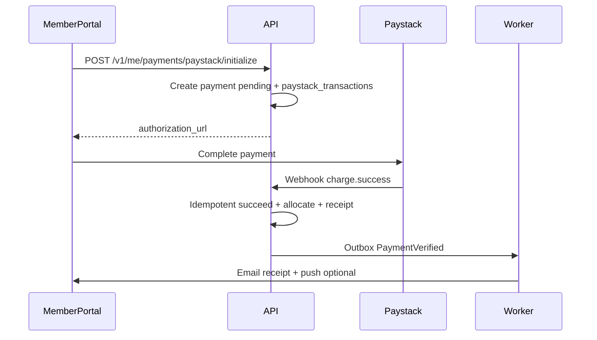
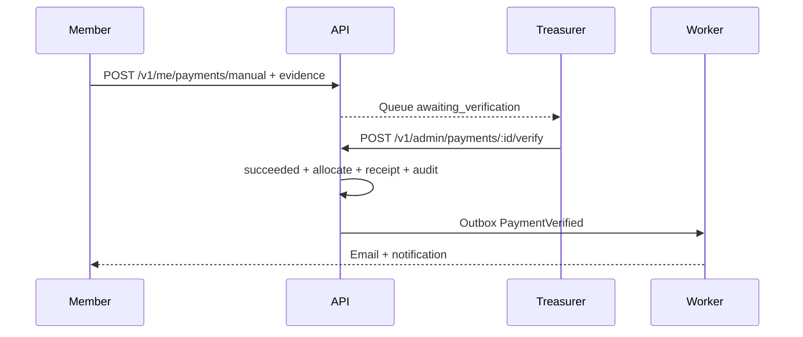

# Association Management Platform — Functional Specification

**Document type:** Feature / Functional Specification (architecture review)  
**Status:** Awaiting approval — no application code until signed off  
**Product:** Multi-tenant Association Management Platform (Ajir)  
**First tenant (configuration only):** NMA Ogun State Branch  
**Related docs:** [Database Architecture](../database/DATABASE_ARCHITECTURE.md), [Prisma schema](../database/schema.prisma)

---

## Table of contents

1. [Purpose and scope](#1-purpose-and-scope)
2. [Actors and personas](#2-actors-and-personas)
3. [Client applications and URL model](#3-client-applications-and-url-model)
4. [Cross-cutting behaviours](#4-cross-cutting-behaviours)
5. [Global navigation maps](#5-global-navigation-maps)
6. [Public website — screens and journeys](#6-public-website--screens-and-journeys)
7. [Authentication journeys](#7-authentication-journeys)
8. [Member portal — screens and journeys](#8-member-portal--screens-and-journeys)
9. [Institutional portal — screens and journeys](#9-institutional-portal--screens-and-journeys)
10. [Organization admin portal — screens and journeys](#10-organization-admin-portal--screens-and-journeys)
11. [Platform Operator console — screens and journeys](#11-platform-operator-console--screens-and-journeys)
12. [End-to-end workflows](#12-end-to-end-workflows)
13. [API interaction catalogue](#13-api-interaction-catalogue)
14. [Notifications and communications matrix](#14-notifications-and-communications-matrix)
15. [Validation, errors, and empty states](#15-validation-errors-and-empty-states)
16. [Permissions → screen matrix](#16-permissions--screen-matrix)
17. [Phase boundaries](#17-phase-boundaries)
18. [Acceptance criteria summary](#18-acceptance-criteria-summary)
19. [Approval checklist](#19-approval-checklist)

---

## 1. Purpose and scope

This specification describes **what the product does from a user and API perspective**: every screen, every primary user journey, and every API interaction required to support those journeys.

It does **not** specify UI pixel design, NestJS module internals, or Flutter widgets. It is the contract between product intent and future implementation.

### In scope (Phase 1 unless noted)

- Multi-tenant public website (CMS-driven)
- Member self-service portal
- Institutional portal (bulk dues, members under institution)
- Organization secretariat / admin portal
- Platform Operator console (Ajir)
- Auth (JWT + refresh), RBAC, file uploads (R2)
- Dues: Paystack + manual evidence
- CMS publish workflows for website content
- CME submit/review (core)
- Events register/list (core)
- Transactional email + basic push registration

### Out of scope for this Phase 1 feature set

- Flutter app (specified as Phase 2 journeys only — §17)
- Cooperative Society module (Phase 3)
- Elections
- National→branch org hierarchy

---

## 2. Actors and personas

| Actor ID | Name | Description | Primary client |
|---|---|---|---|
| A1 | Anonymous Visitor | Public website reader | Web |
| A2 | Member | Association member with personal account | Portal / (later Mobile) |
| A3 | Institution Admin | Manages doctors and remittances for one institution | Portal |
| A4 | Secretariat Staff | Day-to-day org admin (members, CMS, CME) | Portal |
| A5 | Treasurer / Financial Secretary | Payment verification and finance reports | Portal |
| A6 | State / Org Administrator | Full org admin including roles and settings | Portal |
| A7 | Committee Admin | Limited to committee content/members (Phase 2 depth) | Portal |
| A8 | Platform Operator | Ajir staff provisioning tenants | Platform app |
| A9 | System | Workers, webhooks, schedulers | API / workers |

A single human may hold multiple roles (e.g. Member + Treasurer). Screens respect the **union of permissions**.

---

## 3. Client applications and URL model

| App | Code name | Typical host | Audience |
|---|---|---|---|
| Public website | `web` | `nmaogun.com.ng` (tenant domain purpose=`web`) | A1, A2 browsing |
| Tenant portal | `portal` | `app.nmaogun.com.ng` (purpose=`portal`) | A2–A7 |
| Platform console | `platform` | `platform.ajir.example` (Ajir-owned) | A8 |
| API | `api` | `api.nmaogun.com.ng` or shared API host | All clients |
| Mobile | `mobile` | Native Flutter | A2 (Phase 2) |

**Tenant resolution:** every web/portal/api request resolves `Host` → `organization`. No hardcoded NMA strings in UI chrome; org `display_name`, logo, and colors come from branding/CMS.

**Portal shells (one React app, role-based navigation):**

1. Member shell  
2. Institution shell  
3. Admin shell  
4. Shared account/security screens  

User sees shells they are entitled to; a switcher appears when multiple shells apply.

---

## 4. Cross-cutting behaviours

### 4.1 Session and auth

- Access token: short-lived JWT in memory / Authorization header.
- Refresh token: HttpOnly Secure cookie on portal; secure storage on mobile.
- Idle/expiry: refresh silently; on failure redirect to login with `returnUrl`.
- Email verification gate: unverified users may only access “Verify email” and limited profile completion.

### 4.2 Tenancy

- All tenant APIs require resolved organization.
- Cross-tenant access returns `404` (not `403`) for resource IDs to avoid existence leaks where appropriate; `403` when authenticated but lacking permission inside tenant.

### 4.3 Files

- Upload = client requests signed URL → PUT to R2 → confirm API.
- Private files (CME, evidence, receipts, passport) served via short-lived signed GET URLs.
- Public files (website images) may use public R2/CDN URLs after publish.

### 4.4 Idempotency

- Payment initiate, bulk remittance submit, and webhook processing use idempotency keys / unique references.

### 4.5 Audit

- Sensitive actions write `audit_logs` (verify payment, reject payment, activate member, grant exemption, publish content, role changes, org provision).

### 4.6 Feature flags

- Screens for CME, Events, Paystack, Cooperative hide/disable when `organization_features` disabled.

---

## 5. Global navigation maps

### 5.1 Public website (typical seeded sitemap — editable via CMS)

- Home  
- About  
- Executives  
- Past Executives  
- Committees  
- News (list + detail)  
- Events (list + detail; optional “Register” CTA if logged-in deep-link)  
- Gallery  
- Downloads  
- Contact  
- Footer: legal/privacy links (CMS pages)

### 5.2 Member portal nav

- Dashboard  
- My Profile  
- Digital ID / Membership Card  
- Dues & Payments  
- Receipts  
- CME  
- Events  
- Documents / Downloads  
- Notifications  
- Account Security  

### 5.3 Institution portal nav

- Dashboard  
- Affiliated Members  
- Outstanding Balances  
- Bulk Remittance  
- Payment History  
- Reports  
- Institution Profile  

### 5.4 Admin portal nav

- Dashboard  
- Members  
- Institutions  
- Membership Types & Custom Fields  
- Finance (Invoices, Payments Queue, Fee Schedules, Reports)  
- CME Review  
- Events Admin  
- CMS (Pages, News, Blog, Circulars, Gallery, Downloads, Executives, Committees)  
- Communications (Templates, Campaigns)  
- Roles & Users  
- Organization Settings / Branding / Domains (read or manage)  
- Audit Log  

### 5.5 Platform console nav

- Organizations  
- Plans & Subscriptions  
- Platform Users  
- System Health (optional Phase 1 minimal)  

---

## 6. Public website — screens and journeys

### Screen W-01 — Home

**Actor:** A1  
**Purpose:** Brand + primary CTA + latest highlights.  
**Data:** Org branding; featured/latest `content_items` (news); upcoming published `events` (max small set).  
**API:**

| Method | Path | Notes |
|---|---|---|
| GET | `/v1/public/organization` | Branding, display name, social |
| GET | `/v1/public/content?type=news&limit=3` | Latest published |
| GET | `/v1/public/events?upcoming=true&limit=3` | Upcoming |

**Journey J-W01:** Land on home → read headline → click News/Event/About/Contact.

### Screen W-02 — About

**API:** `GET /v1/public/content/by-slug?type=page&slug=about`  
**Empty:** Show CMS empty placeholder only in preview; production seed creates About page.

### Screen W-03 — Executives / W-04 Past Executives

**API:** `GET /v1/public/content?type=executive|past_executive&sort=sort_order`  
Card/list of people from CMS attributes (name, role_title, photo).

### Screen W-05 — Committees list / W-06 Committee detail

**API:**  
- `GET /v1/public/committees`  
- `GET /v1/public/committees/:slug` (+ members)

### Screen W-07 — News list / W-08 News detail

**API:**  
- `GET /v1/public/content?type=news&page=`  
- `GET /v1/public/content/by-slug?type=news&slug=`  
SEO: title/description/OG from content fields.

### Screen W-09 — Events list / W-10 Event detail

**API:**  
- `GET /v1/public/events`  
- `GET /v1/public/events/:slug`  
CTA “Register” → portal login with `returnUrl=/events/:id/register` (A2).

### Screen W-11 — Gallery / W-12 Album detail

**API:** content `gallery_album` + `content_assets`.

### Screen W-13 — Downloads

**API:** `GET /v1/public/content?type=download` — file download via public or signed URL policy.

### Screen W-14 — Contact

**Fields:** name, email, subject, message (+ optional Turnstile later).  
**API:** `POST /v1/public/contact` → queues email to org support address.  
**Success:** thank-you state.

### Journey J-W02 — Discover and read news

1. Home or News nav → W-07  
2. Open article → W-08  
3. Share uses OG metadata  

### Journey J-W03 — Find event and register

1. W-09 → W-10  
2. Register CTA → Auth (if needed) → Member Events register (M-12)  

---

## 7. Authentication journeys

### Screen A-01 — Login

**Fields:** email, password  
**API:** `POST /v1/auth/login` → sets refresh cookie + returns access token + user shells/permissions summary.  
**Errors:** invalid credentials (generic message), disabled account, wrong tenant (email not in this org).

### Screen A-02 — Forgot password

**API:** `POST /v1/auth/password-reset/request` (always generic success).  
Email with link to A-03.

### Screen A-03 — Reset password

**API:** `POST /v1/auth/password-reset/confirm` `{token, newPassword}`.

### Screen A-04 — Verify email

**API:** `POST /v1/auth/verify-email` `{token}` or GET consume link.

### Screen A-05 — Logout

**API:** `POST /v1/auth/logout` (revoke refresh family).

### Screen A-06 — Refresh (silent)

**API:** `POST /v1/auth/refresh` — cookie-based; not a visible screen.

### Journey J-AUTH01 — First login after invite

1. Admin creates/invites user → welcome email with temp link  
2. A-03 or invite accept → set password  
3. A-04 verify if required  
4. Redirect to role-appropriate dashboard  

### Journey J-AUTH02 — Member returns

1. A-01 → Member Dashboard (M-01)  

---

## 8. Member portal — screens and journeys

### Screen M-01 — Member Dashboard

**Shows:** membership status, dues summary (open invoices total), next event, CME pending count, unread notifications.  
**API:**

| Method | Path |
|---|---|
| GET | `/v1/me` |
| GET | `/v1/me/dashboard` |

### Screen M-02 — Profile view / M-03 Profile edit

**Editable:** phone, alternate email, photo, custom fields marked member-editable; name edits may require admin (org setting).  
**API:**  
- `GET /v1/me/profile`  
- `PATCH /v1/me/profile`  
- `POST /v1/me/photograph/upload-url` → confirm  

**Journey J-M01 — Update passport photograph**

1. M-03 → choose image → signed upload → confirm  
2. Digital ID regenerates on next download using new photo  

### Screen M-04 — Digital membership card

**Shows:** on-screen card + Download PDF.  
**API:** `GET /v1/me/membership-card` (JSON for UI) + `GET /v1/me/membership-card.pdf`  
Includes membership number, name, photo, org branding, optional QR payload pointing to public verify URL (Phase 1 optional endpoint `GET /v1/public/members/verify/:token`).

### Screen M-05 — Dues & payments list

**Shows:** open invoices, payment history, Pay / Upload evidence actions.  
**API:**  
- `GET /v1/me/invoices`  
- `GET /v1/me/payments`  

### Screen M-06 — Pay dues (Paystack)

**Precondition:** feature `paystack` enabled; invoice open; member not exempt (or choosing voluntary pay).  
**API:**  
- `POST /v1/me/payments/paystack/initialize` `{invoiceId(s), idempotencyKey}`  
- Redirect/popup to Paystack  
- Return URL → M-07 status poll  
- Webhook: `POST /v1/webhooks/paystack` (system)

**Journey J-M02 — Online dues payment**

1. M-05 → Pay → M-06 initialize  
2. Complete Paystack  
3. Return → pending/success; webhook finalizes `succeeded` + allocation + receipt + email  

### Screen M-07 — Payment status / result

**API:** `GET /v1/me/payments/:id`

### Screen M-08 — Upload payment evidence (manual)

**Fields:** file (PDF/JPG/PNG), bank name, transfer reference, transferred at, note, select invoice(s).  
**API:**  
- `POST /v1/me/payments/manual` `{…}` → `awaiting_verification`  
- Upload file via Files API  

**Journey J-M03 — Manual transfer + admin verification**

1. Member M-08 submit  
2. Admin Finance queue F-04 approve/reject  
3. On approve: allocate, receipt, email; notify member  

### Screen M-09 — Receipts list / M-10 Receipt detail/download

**API:** `GET /v1/me/receipts`, `GET /v1/me/receipts/:id/download`

### Screen M-11 — CME list / M-12 CME upload / M-13 CME detail

**API:**  
- `GET /v1/me/cme`  
- `POST /v1/me/cme` (metadata + file)  
- `GET /v1/me/cme/:id`  

Statuses: pending / approved / rejected (show reason).

### Screen M-14 — Events list / M-15 Event detail / M-16 Register

**API:**  
- `GET /v1/me/events` (published + registration state)  
- `POST /v1/me/events/:id/registrations`  
- `DELETE /v1/me/events/:id/registrations` (cancel if allowed)  

### Screen M-17 — Documents / downloads (member-visible)

**API:** `GET /v1/me/documents` — circulars/downloads targeted to members (may overlap public downloads).

### Screen M-18 — Notifications centre

**API:** `GET /v1/me/notifications`, `POST /v1/me/notifications/:id/read`, `POST /v1/me/notifications/read-all`

### Screen M-19 — Account security

Change password, see sessions (optional Phase 1: logout all).  
**API:** `POST /v1/me/password`, `POST /v1/auth/logout-all`

---

## 9. Institutional portal — screens and journeys

**Precondition:** user has institution admin scope for ≥1 institution. If multiple, I-00 institution switcher.

### Screen I-01 — Institution Dashboard

Outstanding dues for affiliated active members, last remittance status, member count.  
**API:** `GET /v1/institution/dashboard?institutionId=`

### Screen I-02 — Affiliated members

Search/filter members linked via `institution_members`.  
**API:** `GET /v1/institution/members`  
Actions (permissioned): request link / unlink (or request-only in Phase 1 if admin must approve).

### Screen I-03 — Outstanding balances

Per-member open invoice totals.  
**API:** `GET /v1/institution/balances`

### Screen I-04 — Create bulk remittance / I-05 Remittance detail

**Journey J-I01 — Bulk institutional remittance**

1. I-04 select period / fee schedule  
2. System proposes lines from affiliated members with open invoices (editable amounts)  
3. Institution uploads schedule CSV optional (match by membership_no / custom field)  
4. Submit remittance → create `bulk_remittance` + optional initiate payment (Paystack or mark manual)  
5. Unmatched lines flagged for secretariat resolution (Admin F-08)  
6. On payment success + allocation, members’ invoices update  

**API:**  
- `POST /v1/institution/bulk-remittances`  
- `GET /v1/institution/bulk-remittances/:id`  
- `POST /v1/institution/bulk-remittances/:id/submit`  
- `POST /v1/institution/bulk-remittances/:id/paystack/initialize`  
- `POST /v1/institution/bulk-remittances/:id/evidence`  

### Screen I-06 — Payment history

**API:** `GET /v1/institution/payments`

### Screen I-07 — Reports download

CSV/PDF outstanding and remittance summary.  
**API:** `GET /v1/institution/reports/outstanding`, `.../remittances`

### Screen I-08 — Institution profile (read/edit limited)

**API:** `GET/PATCH /v1/institution/profile`

---

## 10. Organization admin portal — screens and journeys

### 10.1 Dashboard

### Screen F-01 — Admin Dashboard

KPIs: active members, pending approvals, payments awaiting verification, pending CME, unpublished drafts (optional).  
**API:** `GET /v1/admin/dashboard`

### 10.2 Members

### Screen F-02 — Members list

Filters: status, institution, membership type, search name/no/custom field.  
**API:** `GET /v1/admin/members`

### Screen F-03 — Member create / invite

**Journey J-F01 — Onboard member**

1. Create member (draft) ± create user invite  
2. Optionally set custom fields (e.g. MDCN number)  
3. Activate → status `active`, optional membership_no allocation  
4. Welcome email via outbox  

**API:** `POST /v1/admin/members`, `POST /v1/admin/members/:id/invite`, `POST /v1/admin/members/:id/activate`

### Screen F-04 — Member detail / edit

Actions: suspend, archive, grant/revoke dues exemption, link institution, reset password send.  
**API:** `GET/PATCH /v1/admin/members/:id`, `POST .../exemption`, `POST .../suspend`

### Screen F-05 — Membership types

CRUD codes/names.  
**API:** `/v1/admin/membership-types`

### Screen F-06 — Custom field definitions

CRUD field definitions for members.  
**API:** `/v1/admin/field-definitions`

### 10.3 Institutions

### Screen F-07 — Institutions list / F-08 detail

Manage institution, assign institution admins, view members, resolve unmatched remittance lines.  
**API:** `/v1/admin/institutions`, `.../admins`, `.../bulk-remittances/:id/resolve-line`

### 10.4 Finance

### Screen F-09 — Fee schedules & rules

**Journey J-F02 — Configure dues year**

1. Create schedule `2026-annual`  
2. Add fee rules (amounts, age bands, `is_optional_exempt` for 70+)  
3. Activate schedule  
4. Generate invoices (batch job)  

**API:**  
- CRUD `/v1/admin/fee-schedules`, `/v1/admin/fee-schedules/:id/rules`  
- `POST /v1/admin/fee-schedules/:id/generate-invoices`  

### Screen F-10 — Invoices list

**API:** `GET /v1/admin/invoices` (+ void/waive actions)

### Screen F-11 — Payments verification queue

**Journey J-F03 — Verify manual payment**

1. Open pending `awaiting_verification`  
2. View evidence (signed URL)  
3. Approve → allocations + receipt + email + notify  
   OR Reject → reason + notify  

**API:**  
- `GET /v1/admin/payments?status=awaiting_verification`  
- `POST /v1/admin/payments/:id/verify`  
- `POST /v1/admin/payments/:id/reject`  

### Screen F-12 — Payment detail (all channels)

### Screen F-13 — Finance reports

Collections by period, outstanding aging, institution remittance summary.  
**API:** `GET /v1/admin/reports/finance?*`

### 10.5 CME admin

### Screen F-14 — CME review queue / F-15 detail

Approve/reject.  
**API:** `GET /v1/admin/cme`, `POST /v1/admin/cme/:id/approve`, `.../reject`

### 10.6 Events admin

### Screen F-16 — Events list / F-17 create-edit / F-18 registrations

Manage speakers, assets, export registrations.  
**API:** `/v1/admin/events`, `.../speakers`, `.../assets`, `.../registrations`

### 10.7 CMS

### Screen F-19 — Content list by type

### Screen F-20 — Content editor

Fields: title, slug, body, SEO, cover, schedule, attributes.  
**Journey J-F04 — Publish news**

1. Draft save  
2. Preview (optional tokenized public preview URL)  
3. Publish → `ContentPublished` → website revalidation hook  
4. Optional announce to members  

**API:**  
- `GET/POST/PATCH /v1/admin/content`  
- `POST /v1/admin/content/:id/publish`  
- `POST /v1/admin/content/:id/unpublish`  

Covers: pages, news, blog, circulars, downloads, gallery albums, executives, past executives.

### Screen F-21 — Committees admin

**API:** `/v1/admin/committees`, `.../members`

### 10.8 Communications

### Screen F-22 — Email templates

**API:** `GET/PATCH /v1/admin/email-templates`

### Screen F-23 — Campaign composer / F-24 campaign detail

Audience: all members / filter (institution, type, status) / selected IDs.  
**API:** `POST /v1/admin/email-campaigns`, `POST .../:id/queue`  
Worker sends via provider adapter; deliveries tracked.

### 10.9 Access control & settings

### Screen F-25 — Roles & permissions

Edit non-system roles; assign permissions.  
**API:** `/v1/admin/roles`, `.../permissions`

### Screen F-26 — Staff users

Invite admin users, assign roles.  
**API:** `/v1/admin/users`

### Screen F-27 — Organization settings

Timezone, currency, dues year start, support email, membership number format settings.  
**API:** `GET/PATCH /v1/admin/organization/settings`

### Screen F-28 — Branding

Logo/colors/from-email.  
**API:** `GET/PATCH /v1/admin/organization/branding`

### Screen F-29 — Domains (org-admin read; changes may be platform-only in Phase 1)

**API:** `GET /v1/admin/organization/domains`

### Screen F-30 — Audit log viewer

**API:** `GET /v1/admin/audit-logs`

---

## 11. Platform Operator console — screens and journeys

### Screen P-01 — Login (platform auth — separate cookie domain)

**API:** `POST /v1/platform/auth/login`

### Screen P-02 — Organizations list / P-03 Organization detail

### Screen P-04 — Provision organization wizard

**Journey J-P01 — Provision tenant**

1. Enter legal/display name, slug, org_type, plan  
2. Create org + default roles + permissions + feature flags defaults  
3. Attach domains (web/portal/api) + verification instructions  
4. Seed optional CMS page tree template (About, etc.) empty or placeholder  
5. Create initial Org Administrator user invite  
6. Status → `active` when domains verified (or manual activate)  

**API:**  
- `POST /v1/platform/organizations`  
- `POST /v1/platform/organizations/:id/domains`  
- `POST /v1/platform/organizations/:id/features`  
- `POST /v1/platform/organizations/:id/activate`  
- `POST /v1/platform/organizations/:id/admins`  

### Screen P-05 — Plans & subscriptions

**API:** `/v1/platform/plans`, `/v1/platform/organizations/:id/subscription`

### Screen P-06 — Platform users

**API:** `/v1/platform/users`

### Screen P-07 — Impersonation / support login (audited) — Phase 1 optional but recommended

**API:** `POST /v1/platform/organizations/:id/support-session` → time-boxed token; every action audit-flagged.

---

## 12. End-to-end workflows

### WF-01 Member pays dues via Paystack

### WF-02 Manual evidence verification

### WF-03 Institutional bulk remittance

1. Institution builds remittance lines  
2. Pays (Paystack or evidence)  
3. System allocates to member invoices where matched  
4. Admin resolves unmatched lines  
5. Reports update  

### WF-04 CMS publish to website

1. Admin publishes content  
2. Outbox `ContentPublished`  
3. Worker calls Cloudflare Pages revalidation URL  
4. Public site serves new content  

### WF-05 CME approval

1. Member uploads certificate  
2. Admin approves/rejects  
3. Member notified  

### WF-06 Event registration

1. Member registers  
2. Capacity check  
3. Confirmation email  
4. Optional reminder job before start  

### WF-07 Password reset

1. Request → email  
2. Confirm token → new password  
3. Revoke refresh families  

### WF-08 Dues exemption age 70+

1. Rule: fee_rule `is_optional_exempt` + member age from DOB ≥ configured threshold (org setting, not hardcoded 70 in code — default seed 70 for medical orgs)  
2. Admin grants exemption OR member requests (Phase 1: admin-only grant)  
3. Invoice generation skips or waives per policy  

---

## 13. API interaction catalogue

Base: `/v1`. Auth: Bearer access token unless `public` or webhook.

### 13.1 Public

| Action | Method | Path | Auth |
|---|---|---|---|
| Org branding | GET | `/public/organization` | Host |
| Content list | GET | `/public/content` | Host |
| Content by slug | GET | `/public/content/by-slug` | Host |
| Committees | GET | `/public/committees` | Host |
| Committee detail | GET | `/public/committees/:slug` | Host |
| Events list/detail | GET | `/public/events`, `/public/events/:slug` | Host |
| Contact form | POST | `/public/contact` | Host (+ rate limit) |
| Member verify QR | GET | `/public/members/verify/:token` | Host (optional P1) |

### 13.2 Auth

| Action | Method | Path |
|---|---|---|
| Login | POST | `/auth/login` |
| Refresh | POST | `/auth/refresh` |
| Logout | POST | `/auth/logout` |
| Logout all | POST | `/auth/logout-all` |
| Password reset request/confirm | POST | `/auth/password-reset/request`, `/confirm` |
| Verify email | POST | `/auth/verify-email` |

### 13.3 Me (member)

| Area | Paths |
|---|---|
| Profile | `GET/PATCH /me`, `/me/profile`, photograph upload |
| Card | `/me/membership-card`, `.pdf` |
| Finance | `/me/invoices`, `/me/payments`, paystack init, manual pay, `/me/receipts` |
| CME | `/me/cme` CRUD submit |
| Events | `/me/events`, registrations |
| Docs | `/me/documents` |
| Notifications | `/me/notifications` |
| Security | `/me/password` |

### 13.4 Institution

| Area | Paths |
|---|---|
| Context | `/institution/dashboard`, `/profile` |
| People | `/institution/members`, `/balances` |
| Remittance | `/institution/bulk-remittances` (+ submit, pay, evidence) |
| History/Reports | `/institution/payments`, `/institution/reports/*` |

### 13.5 Admin

| Area | Paths |
|---|---|
| Dashboard | `/admin/dashboard` |
| Members | `/admin/members`, activate, exemption, invite |
| Types/Fields | `/admin/membership-types`, `/admin/field-definitions` |
| Institutions | `/admin/institutions`, admins, remittance resolve |
| Finance | fee-schedules, rules, generate-invoices, invoices, payments verify/reject, reports |
| CME/Events | `/admin/cme`, `/admin/events` |
| CMS | `/admin/content`, publish, committees |
| Comms | templates, campaigns |
| IAM | roles, users |
| Settings | organization settings/branding/domains |
| Audit | `/admin/audit-logs` |

### 13.6 Files

| Action | Method | Path |
|---|---|---|
| Create upload URL | POST | `/files/upload-url` |
| Confirm upload | POST | `/files/:id/confirm` |
| Download URL | GET | `/files/:id/download-url` |

### 13.7 Webhooks & platform

| Action | Method | Path |
|---|---|---|
| Paystack | POST | `/webhooks/paystack` |
| Platform auth/orgs/plans | `/platform/*` | Operator JWT |

### 13.8 Common API conventions

- Error envelope: `{ code, message, details[] }`  
- Pagination: cursor `?cursor=&limit=`  
- Filtering: query params documented per list endpoint  
- Idempotency: header `Idempotency-Key` on payment/remittance mutations  

---

## 14. Notifications and communications matrix

| Event | Email | In-app | Push (when FCM registered) |
|---|---|---|---|
| Welcome / invite | Yes | No | No |
| Verify email | Yes | No | No |
| Password reset | Yes | No | No |
| Payment succeeded / receipt | Yes | Yes | Optional |
| Payment rejected | Yes | Yes | Optional |
| Payment reminder (scheduled job) | Yes | Yes | Optional |
| CME approved/rejected | Yes | Yes | Optional |
| Event registration confirm | Yes | Yes | Optional |
| Event reminder | Yes | Yes | Optional |
| Announcement/campaign | Yes | Optional | Optional |
| Member activated | Yes | Yes | Optional |

Templates keyed per org in `email_templates` (`welcome`, `password_reset`, `payment_receipt`, `payment_rejected`, `cme_status`, `event_registration`, `payment_reminder`, …).

---

## 15. Validation, errors, and empty states

| Situation | Behaviour |
|---|---|
| Validation failure | 400 + field errors; form shows inline messages |
| Unauthenticated | 401 → login with returnUrl |
| Forbidden | 403 page in portal; API 403 |
| Not found | 404 page |
| Feature disabled | Hide nav + 404/403 on API |
| Paystack failure | Payment `failed`; user can retry new reference |
| Upload too large / bad MIME | Reject at upload-url or confirm |
| Invoice already paid | Pay action disabled; API 409 |
| Event full | Register returns 409 capacity |
| Soft-deleted entities | Treated as not found for non-platform users |
| Empty lists | Dedicated empty state + CTA (e.g. “No dues outstanding”) |

---

## 16. Permissions → screen matrix

| Permission (examples) | Screens unlocked |
|---|---|
| (authenticated member) | M-* |
| `institution.members.manage` / institution scope | I-* |
| `members.read` | F-02, F-04 read |
| `members.write` | F-03, F-04 edit, activate |
| `payments.verify` | F-11, F-12 verify/reject |
| `reports.finance` | F-13 |
| `cme.review` | F-14, F-15 |
| `events.manage` | F-16–F-18 |
| `cms.publish` | F-19–F-21 publish |
| `comms.campaign` | F-23, F-24 |
| `roles.manage` | F-25, F-26 |
| `org.settings` | F-27, F-28 |
| `audit.read` | F-30 |
| Platform operator | P-* |

Exact permission keys live in DB seed; UI hides unauthorized nav items and blocks deep links.

---

## 17. Phase boundaries

### Phase 1 (specify fully above — implement after approvals)

Website, portal shells (member/institution/admin), platform provision, dues Paystack+manual, CMS publish, CME core, events core, email transactional + campaigns basic, FCM token register (push send basic).

### Phase 2 — Mobile + depth (journey summary only)

| Mobile screen | Parity with |
|---|---|
| Login | A-01 |
| Home | M-01 |
| Digital ID | M-04 |
| Payments | M-05–M-10 |
| CME upload | M-11–M-13 |
| Events / News | M-14+, public news via API |
| Notifications | M-18 |

Also Phase 2 web: attendance check-in, richer campaigns, MFA for finance, Excel import wizard screens.

### Phase 3 — Cooperative

Separate functional spec when module starts (accounts, loans, guarantors, statements).

---

## 18. Acceptance criteria summary

1. Visitor can browse all seeded public pages for a tenant without authentication.  
2. Admin can publish news and see it on the public site without redeploying code.  
3. Member can log in, update profile/photo, view dues, pay via Paystack, and download receipt.  
4. Member can upload transfer evidence; treasurer can verify/reject with audit trail.  
5. Institution admin can submit bulk remittance affecting multiple member invoices.  
6. Doctors 70+ can be exempted via admin + fee rules without code change.  
7. Member can upload CME; admin can approve/reject.  
8. Member can register for a published event.  
9. Platform operator can provision a new org + domains + admin invite with zero code change.  
10. No tenant can read another tenant’s data via API (RLS + tests).  
11. All sensitive money/admin actions appear in audit log.  

---

## 19. Approval checklist

Please confirm or request changes:

- [ ] Actor list and portal shells are correct  
- [ ] Public website screen list matches product expectations  
- [ ] Member journeys (pay, evidence, CME, events, card) complete for Phase 1  
- [ ] Institution bulk remittance workflow acceptable  
- [ ] Admin CMS + finance + CME + events screens sufficient  
- [ ] Platform provisioning wizard sufficient  
- [ ] API catalogue adequate to drive OpenAPI later  
- [ ] Phase 2/3 deferrals acceptable  
- [ ] Notification matrix acceptable  

**No NestJS, React, Astro, Flutter, or migration application proceeds until this Functional Specification is approved** (together with the already-reviewed database architecture).

---

## Document history

| Version | Date | Notes |
|---|---|---|
| 0.1 | 2026-08-04 | Initial complete functional specification for architecture review |
